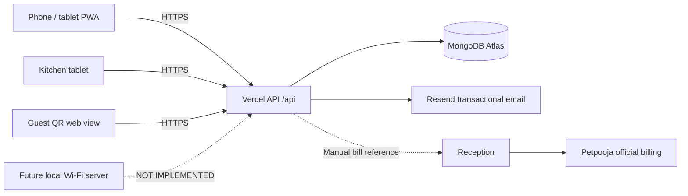

# Architecture and database design

## Trust boundaries

- Browser code cannot see database keys, Resend API keys, token hashes or password hashes.
- Owner account is created only by trusted CLI. Password setup/invitation/reset links are generated using cryptographic randomness; MongoDB stores token SHA-256 hashes and expiry, not plaintext tokens.
- Owner, Manager, Chef, Waiter and Reception API permissions use server-side role checks (`lib/core.js`). A query parameter never grants a role.
- MongoDB sessions contain only hashes of randomly generated session cookies; the cookie is HttpOnly, Secure and SameSite=Strict for HTTPS deployments.
- Guest QR table links use a separate random key hash. Customer order-status links use a separate unpredictable tracking token, and the public response excludes internal notes.

## Implemented collections and indexes

- `users`: unique email, partial unique owner role; inactive pending invitations, scrypt password hash and role.
- `setup_tokens`: unique token hash, expiration TTL, user index, usedAt for one-use redemption.
- `otps`: unique challenge id, expiry TTL, HMAC(code, SESSION_SECRET).
- `sessions`: unique hashed cookie; expiry TTL.
- `rate_limits`: per-action/IP/email time-bucket counters; expiry TTL.
- `tables`: unique table number and hashed table QR key.
- `menu`: unique dish name (seed/update); category and availability.
- `orders`: unique client idempotency key, unique order number, unique private customer track token hash; append-only history of state transitions.
- `calls`: table number, type and claim/complete states.
- `stock` and `stock_movements`: on-hand totals and record of signed change/reason/actor; improvements to true transactional stock ledger are pending.
- `tasks`, `leave`, `closing`, `audit`: operational activity and event history.

## State model

Waiter creates order -> server stores `sent` -> chef deliberately acknowledges `received` -> chef begins `preparing` -> chef marks `ready` -> waiter confirms `served`.

`billingStatus` is entirely separate (`unmatched`, `matched`, `needs_review`); a real Petpooja reference is required before matching. Do not infer payments from cooking progress.

## Important limits

- Orders are stored in MongoDB when online; **offline storage, local-server receipt and robust retries need a dedicated second phase**.
- No physical call-button hardware has been selected or provisioned.
- Waste evidence, supplier ledger, approval segregation, attendance imports, loyalty, detailed audits and notification escalations need additional implementation.
- Database transactions and restorability must be exercised with the selected Atlas tier and configuration during the pilot.
